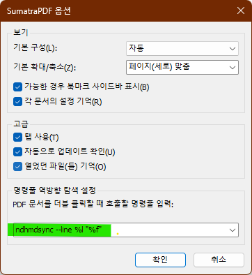
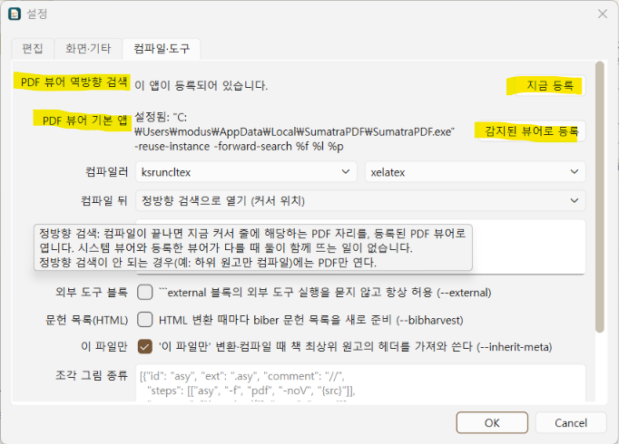

이 문서는 ndhmdSuite를 **설치해서 첫 PDF를 뽑기까지**만 다룬다. 기능 전체는 [ndhmdWriter 설명서](ndhmdwriter-manual.html)와 [ndhmd4tex 방언 사양서](ndhmd4tex-dialect-guide.html)를 찾아보면 된다.

## 준비물

- **TeX Live**(2026 계열) 또는 **MiKTeX**이 먼저 설치되어 있어야 한다. 컴파일은 TeX이 한다.
- Windows에서는 별도의 Python 설치가 필요 없다. 설치 프로그램에 모두 들어 있다.

## 설치 (Windows)

1. 홈페이지에서 **ndhmdSuite_Setup.exe**를 내려받아 실행한다. 모든 사용자(관리자 권한 필요) 또는 현재 사용자 설치를 고를 수 있다.
2. 이전 버전이 있으면 설치 프로그램이 먼저 깨끗이 지울지 묻는다. 지우고 진행하면 된다.
3. 언어(영어 또는 한국어)를 고르고 마법사를 따라간다.

설치가 끝나면 다음이 자동으로 되어 있다.

- 설치 폴더가 `PATH`에 들어가서 명령 프롬프트 어디서나 `ndhmd4tex` 같은 명령을 쓸 수 있다.
- 컴파일 래퍼 `ksruncltex`가 설정되어 있다. 따로 설치할 것이 없다.
- 바탕화면과 시작 메뉴에 **ndhmdwriter** 바로가기가 생긴다.

> **경로에 한글과 공백을 함께 쓰지 않는다.** 경로에 한글이 있으면 PDF 뷰어와의 동기화가 되지 않고, 한글과 공백이 둘 다 있으면 컴파일이 오류로 끝난다. 사용자 계정 이름이 한글이면 `C:\Users\계정이름\…` 아래가 모두 여기에 걸리므로, 작업 폴더는 `C:\work\book`처럼 영문·숫자로 된 경로에 둔다.

macOS와 Linux는 [ndhmd4tex 저장소의 INSTALLATION.md](https://github.com/xltxlvr/ndhmd4tex/blob/main/INSTALLATION.md)를 따른다.

## 처음 실행: 작업공간 고르기

바로가기로 **ndhmdwriter**를 실행한다. 처음에는 **작업공간** 폴더를 고르라는 창이 뜬다. 원고를 모아 둘 빈 폴더(예: `C:\work\book`)를 만들어 고른다. 다음 실행부터는 마지막 작업공간이 자동으로 열린다. 나중에 바꾸려면 **파일 ▶ 작업공간 열기**(`Ctrl+Shift+O`)를 쓴다.

앱은 작업공간 **바로 아래**의 `.md` `.txt` `.nmd` `.mmd` 파일만 원고로 본다. 왼쪽 **서랍**에 원고 목록이 나온다.

## 첫 원고 쓰기

`Ctrl+N`을 눌러 새 원고 `hello.md`를 만들고 다음을 적는다. 머리말(yaml) 없이 마크다운만 적어도 된다.

```markdown
# 안녕, ndhmd

이건 **첫 문서**다. *기울임*도 되고, 각주도 됩니다[^a].

[^a]: 각주 예시.
```

`Ctrl+S`로 저장한다.

## PDF 만들기

**컴파일 ▶ 책 컴파일**(`Ctrl+Shift+B`)을 누른다. 앱은 두 단계로 일한다.

1. ndhmd4tex가 원고를 `hello.tex`로 바꾼다.
2. TeX이 `hello.tex`를 조판해 `hello.pdf`를 만든다.

`hello.tex`, `hello.pdf` 등은 원고와 **같은 폴더**에 생긴다. 컴파일이 성공하면 PDF가 열린다. SumatraPDF가 있으면 그것으로, 없으면 시스템 기본 뷰어로 열린다.

컴파일 전에 마크업에 실수가 없는지만 보고 싶으면 **컴파일 ▶ 마크업 점검**(`Ctrl+Shift+K`)을 쓴다. 컴파일이 실패하면 콘솔 창에 로그가 나오고, **오류 위치로** 버튼을 누르면 원고의 해당 줄로 이동한다.

## 원고와 PDF 오가기

원고에서 커서를 둔 줄에 해당하는 PDF 자리를 보려면 **컴파일 ▶ PDF에서 이 위치 보기**(`Ctrl+Alt+F`)를 쓴다.

반대로 PDF를 더블클릭해서 원고의 해당 줄로 돌아오는 **역방향 검색**은 처음에 한 번 설정해 두어야 한다. PDF 뷰어는 SumatraPDF를 기준으로 설명한다.

### 1. SumatraPDF에 역방향 검색 명령 넣기

SumatraPDF를 실행해 **메뉴 ▶ 설정 ▶ 옵션**을 연다. 맨 아래 **명령줄 역방향 탐색 설정** 칸에 다음을 그대로 적고 **확인**을 누른다.

```
ndhmdsync --line %l "%f"
```



### 2. ndhmdWriter에서 뷰어 등록하기

ndhmdWriter를 실행(바탕화면 아이콘을 더블클릭)하고 **설정 ▶ 환경설정**을 연다.

1. **PDF 뷰어 역방향 검색** 줄의 **지금 등록**을 누른다.
2. **PDF 뷰어 기본 앱** 줄의 **감지된 뷰어로 등록**을 누른다.



이제 PDF에서 문장을 더블클릭하면 ndhmdWriter가 해당 원고 줄로 커서를 옮긴다. 자세한 동작은 설명서의 [역방향 검색](ndhmdwriter-manual.html#sec-inverse)을 본다.

## 문서마다 다르게: front matter

머리말이 없으면 설치 때 함께 들어온 기본 설정으로 조판된다. 문서마다 바꾸고 싶으면 원고 맨 위에 yaml 머리말을 붙인다.

```yaml
---
title: 첫 문서
author: 홍길동
toplevel: section
preamble+: |
  \usepackage{amsmath,amssymb}
---
```

- `title`, `author`는 `\title{}`, `\author{}`로 나간다. 본문에 `\maketitle`을 적어야 실제로 찍힌다.
- `toplevel: section`은 마크다운 `#`을 `\section`으로 만든다. 기본 설정은 `chapter`이므로 짧은 글에는 이렇게 낮춘다.
- `preamble+:`는 기본 프리앰블 **뒤에 덧붙는다**. `preamble:`로 적으면 기본 프리앰블을 통째로 갈아치우니, 패키지를 보태는 정도라면 거의 언제나 `preamble+:`가 맞다.

머리말의 나머지 키는 [방언 사양서 2장](ndhmd4tex-dialect-guide.html#id-2-front-matter)에 있다.

## 여러 파일로 책 만들기

장마다 원고를 따로 두고, 책 전체를 담당하는 원고에서 `{{파일이름}}` 줄로 불러온다. 한 줄에 하나씩, 줄 전체가 `{{이름}}`이어야 한다.

```markdown
# 우리 책

{{ch1.md}}

{{ch2.md}}
```

서랍에서 원고를 끌어다 놓으면 앱이 이 줄을 대신 고쳐 준다. 어느 장 파일을 열어 두었더라도 **책 컴파일**은 책 전체를 만든다. 하나만 보고 싶을 때는 **이 파일만 컴파일**(`Ctrl+Alt+B`)을 쓴다.

## 명령줄에서

앱 없이 터미널에서도 같은 일을 할 수 있다. 설치 때 `PATH`가 잡혔으므로 어느 폴더에서나 된다.

```bash
ndhmd4tex hello.md --pdfxe
```

markdown → tex → PDF까지 한 번에 끝난다. 엔진은 `--pdfxe`(xelatex), `--pdflua`(lualatex), `--pdf`(pdflatex) 중에서 고른다. 한글 문서에는 보통 앞의 둘을 쓴다. 옵션 없이 `ndhmd4tex hello.md`만 실행하면 `.tex`만 만든다. 설정이 어디서 왔는지 헷갈릴 때는 `--dump-meta`로 병합된 최종 머리말을 볼 수 있다.

## 다음에 볼 곳

- 메뉴와 화면을 하나씩 알고 싶다면 [ndhmdWriter 설명서](ndhmdwriter-manual.html)
- 문법을 찾아보려면 [ndhmd4tex 방언 사양서](ndhmd4tex-dialect-guide.html). 앱에서는 **도움말 ▶ ndhmarkdown ▶ 사양서 / 치트시트**로 PDF판을 열 수 있다.
- 바로 변환해 볼 수 있는 [ndhmd4tex 예제](https://github.com/xltxlvr/ndhmd4tex/tree/main/samples)(GitHub): 논문, 에세이, Beamer, 참고문헌 등
- 단축키 전체는 설명서 [부록 A](ndhmdwriter-manual.html#app-shortcuts)
